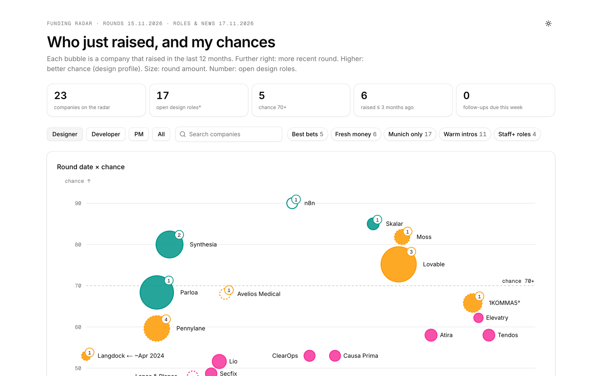
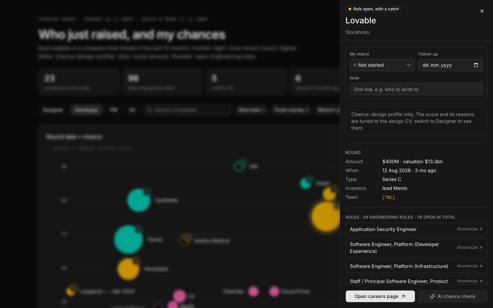

# funding-radar

[](https://github.com/sergushkincom/funding-radar/actions/workflows/refresh.yml)
[](LICENSE)
[](https://funding-radar-two.vercel.app)

Which Munich-area startups just raised money, which of them are hiring, and where a product designer's chances are best.

One screen for one question a job search keeps coming back to: **who has fresh money, an open role, and a reason to talk to me now?**

**Live:** [funding-radar-two.vercel.app](https://funding-radar-two.vercel.app)



## What it does

- **Round date × chance.** Each bubble is a company that raised in the last 12 months:
  - further right = more recent round;
  - higher = better chance;
  - size = round amount;
  - the number = open roles.
- **Role families.** `Designer · Developer · PM · All` switches what the numbers count: design, engineering + data/ML, product, or every role.
- **Find.** Search, quick presets (Best bets, Fresh money, Munich only, Warm intros, Staff+ roles), clickable KPIs, and [ReUI](https://reui.io) Filters for group, chance, role level, workplace, round stage, freshness and amount.
- **Company panel:**
  - the chance with its five factors;
  - the round, the open roles with links, and the hiring signal (roles posted in the last 30 days);
  - the latest news with source links;
  - links to the site and the careers page.
- **Track.** Status per company (Saved, Applied, Intro sent, Interviewing, Rejected, Offer), a follow-up date and a one-line note. They are stored in your browser only (localStorage).
- **New since last visit.** A dot on companies with a new round, a new design role, or hiring news since you last opened the page.



## How the chance works

A transparent rule-based estimate for one product-design profile (B2B / ERP, AI agents, Munich or remote in Germany). It is not a forecast, and it shows only in the Designer view.

| Factor | Points |
|---|---|
| Round freshness | 20 |
| Design role level | 35 (Staff/Principal 35, Senior or Design Engineer 25, Design Manager 22, other 15, none 5; −10 if open for more than 9 months) |
| Topic fit | 25 |
| Munich or remote in Germany | 10 |
| Design team | 10 (first designer 10, no designer yet 8, Head of Design in place 0, unknown 5) |

The rules live in `lib/radar.ts`. Gaps in the data stay `[TBC]`; nothing is estimated to fill them.

## Data

- `data/companies.json`: 39 companies (23 on the radar, 16 in the background without a round date). The rounds are from public sources, researched on 15.11.2026. Amounts are in the round's currency.
- `data/feed.json`: open roles and news, refreshed daily:
  - **Roles** come from the public [Ashby posting API](https://developers.ashbyhq.com/) and Personio XML feeds. They are sorted into families by the job-title rules in `lib/role-family.mjs`.
  - **News** comes from Google News RSS and always links to the original source. A company's name has to appear as a whole word; names that are also common words need a context word too. Where a name is too ambiguous, there is no news (`[TBC]`).
- `data/sources.json`: careers boards, sites and news filters per company.

## Daily refresh

A GitHub Actions workflow runs `scripts/refresh.mjs` every morning (05:15 UTC). It commits the new `data/feed.json`, and Vercel redeploys.

There are no API keys, no database and no backend: public feeds in, a JSON file out.

```bash
node scripts/refresh.mjs   # same run, locally
```

## Run

```bash
pnpm install
pnpm dev          # http://localhost:3000
pnpm lint
pnpm build
```

## Stack

Next.js 16 (App Router), React 19, TypeScript, Tailwind CSS 4, [shadcn/ui](https://ui.shadcn.com) (Radix, Vega), [ReUI](https://reui.io) Data Grid and Filters (TanStack Table), next-themes. The chart is hand-drawn SVG, so the bubble labels never overlap.

Set up with:

```bash
pnpm dlx shadcn@latest init -b radix -p vega
pnpm dlx shadcn@latest add @reui/data-grid @reui/filters
pnpm dlx shadcn@latest add chart sheet card badge button toggle-group popover select
```

`components/ui` and `components/reui` hold the registry code as shipped, so `shadcn add --overwrite` can update it.

## What I learned

- **shadcn registries aren't packages.** `shadcn add @reui/data-grid` copies the source into the repo. The Filters component only holds the query tree; turning it into a row filter is a short function you write yourself (`components/radar/filters.tsx`).
- **A scheduled job can be just Git.** A daily GitHub Action that commits a JSON file and lets Vercel redeploy replaces a cron server, a database and their secrets.
- **Matching news to a company is the hard part.** "Moss", "Lio" or "Finn" match anything. Exact names plus a context word, and showing nothing when unsure, beat a long list of wrong headlines.
- **Keep rules in one file.** The job-title rules are shared by the refresh script and the UI, so a fix lands everywhere.

## License

MIT, see [LICENSE](LICENSE). News items belong to their publishers and are only linked.
